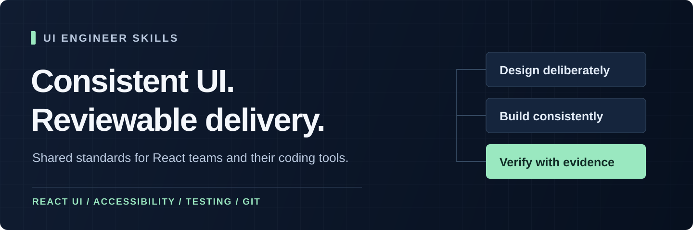

<p align="center">
  
</p>

<h1 align="center">UI Engineer Skills</h1>

<p align="center">
  <strong>Give every UI change a shared engineering standard.</strong><br>
  Practical, versioned workflows for React design, implementation, accessibility, testing, and Git.<br>
  Built for GitHub Copilot CLI, with portable skills for Cursor, Codex, Claude Code, and OpenCode.
</p>

<p align="center">
  <a href="#quick-start">Get started</a> &nbsp; / &nbsp;
  <a href="#the-skill-library">Explore the skills</a> &nbsp; / &nbsp;
  <a href="#evaluate-before-you-roll-out">Review the evaluation model</a> &nbsp; / &nbsp;
  <a href="docs/enterprise-adoption.md">Plan a team rollout</a>
</p>

<p align="center">
  <strong>10 focused skills</strong> &nbsp; / &nbsp;
  <strong>39 supporting guides</strong> &nbsp; / &nbsp;
  <strong>50 evaluation cases</strong> &nbsp; / &nbsp;
  <strong>5 client setup paths</strong>
</p>

## Shared standards. Applied where the work happens.

Teams already have components, review expectations, accessibility requirements, and delivery controls. This collection helps coding tools work within those conventions, from the first design decision to the final Git operation.

Each skill provides a practical process, decision rules, failure cases, and verification criteria. Detailed guides load according to the task. Everything lives in ordinary, reviewable repository files.

<table>
  <tr>
    <td width="33%" valign="top">
      <strong>Consistency across contributors</strong><br><br>
      Reuse existing tokens, components, state ownership, and project conventions. Make important decisions explicit before implementation.
    </td>
    <td width="33%" valign="top">
      <strong>Changes reviewers can assess</strong><br><br>
      Prefer small, complete changes with clear scope, preserved behavior, and practical Git workflows.
    </td>
    <td width="33%" valign="top">
      <strong>Evidence behind the handoff</strong><br><br>
      Match verification to the claim. Separate passing tests, browser observations, performance measurements, and unverified assumptions.
    </td>
  </tr>
</table>

## Quick start

Install for GitHub Copilot CLI from a local checkout:

```sh
git clone https://github.com/sagarb3/ui-engineer-skill.git
cd ui-engineer-skill
mkdir -p "$HOME/.copilot/skills"
cp -Ri skills/. "$HOME/.copilot/skills/"
```

Start a new session or run `/skills reload`. The copy command asks before replacing existing files. These POSIX-shell commands install instructions only; no application packages are added.

Try a focused request in your application repository:

```text
Use harness and react-accessibility to review the checkout form.
Identify keyboard, focus, and labeling barriers. Do not edit files.
```

For team distribution, copy approved skill folders into the application's `.github/skills/` directory. Pin a reviewed revision and preserve existing project instructions. A discovered skill does not automatically become the baseline for every task.

**[Full installation and activation guide](docs/installation.md)**

<details>
<summary><strong>Use Cursor, Codex, Claude Code, or OpenCode</strong></summary>

| Client | Project skills | Personal skills |
| --- | --- | --- |
| Cursor | `.cursor/skills/` | `~/.cursor/skills/` |
| Codex | `.agents/skills/` | `~/.agents/skills/` |
| Claude Code | `.claude/skills/` | `~/.claude/skills/` |
| OpenCode | `.opencode/skills/` | `~/.config/opencode/skills/` |

Copy complete skill folders, including guides and metadata, then verify discovery in the installed client. See the [installation guide](docs/installation.md#other-supported-clients) for invocation details and official documentation. Live behavior must be verified against the host and version your team uses.

</details>

## The skill library

| Skill | What it brings to the workflow |
| --- | --- |
| [Harness](skills/harness/SKILL.md) | A baseline for scope, clarification, ownership, verification, and delivery |
| [UI design direction](skills/ui-design-direction/SKILL.md) | Product-specific concepts, composition, responsive reconstruction, media, motion, and review |
| [React component practices](skills/react-component-practices/SKILL.md) | Clear state ownership, pure rendering, correct effects, identity, and async lifecycle |
| [Component API design](skills/component-api-design/SKILL.md) | Understandable props, valid states, composition, and consumer compatibility |
| [Design system consistency](skills/design-system-consistency/SKILL.md) | Existing tokens, components, variants, themes, and visual-regression discipline |
| [React accessibility](skills/react-accessibility/SKILL.md) | Semantic controls, form feedback, keyboard interaction, focus, and honest audits |
| [Vitest + React Testing Library](skills/vitest-react-testing/SKILL.md) | Behavior-focused scenarios, meaningful assertions, deterministic async work, and mock boundaries |
| [React UI performance](skills/react-ui-performance/SKILL.md) | Reproducible diagnosis, targeted changes, and comparable before-and-after evidence |
| [Git tooling](skills/git-tooling/SKILL.md) | Direct routine commands, protected user work, and explicit history-changing boundaries |
| [Trim mode](skills/trim-mode/SKILL.md) | Smaller complete implementations and concise replies when explicitly requested |

Each skill is self-contained. Its `SKILL.md` routes relevant work to local guides, and `references.json` makes those guides discoverable to tooling. Copy the whole folder; no companion skill is required.

The UI design skill includes twelve specialist guides, from [concept exploration](skills/ui-design-direction/guides/design-brief-and-exploration.md) and [scroll storytelling](skills/ui-design-direction/guides/scroll-storytelling.md) to [visual review](skills/ui-design-direction/guides/visual-review.md) and [usability walkthroughs](skills/ui-design-direction/guides/usability-walkthrough.md). Each other skill has three focused guides.

## An operating model teams can review

| Principle | Expected behavior |
| --- | --- |
| Scope discipline | Make the smallest complete change. Preserve existing architecture and unrelated work. |
| Clear decisions | Investigate repository facts directly. Ask before implementing unresolved requirements. |
| Practical Git | Run straightforward authorized commands directly. Obtain exact approval for destructive actions and history rewriting. |
| Existing controls | Keep repository permissions, hooks, signing, review, and branch protection authoritative. |
| Accessible delivery | Preserve validation, error handling, security, and accessibility in every mode. |
| Honest evidence | Report what actually ran, what passed, and what remains unverified. |

**Output isolation is part of the standard.** Generated code must contain no AI attribution, authoring-tool references, or links back to this collection. Keep workflow metadata out of product code, comments, commits, and documentation. Preserve required legal notices and legitimate ownership records.

All content is in English. These are working instructions; enforcement and data handling remain the responsibility of the selected host, provider, repository controls, and organizational policies.

**[Read the operating model](docs/operating-model.md)**

## Evaluate before you roll out

Fifty cases cover normal work, ambiguity, scope, safeguards, activation, and multi-turn behavior. Local fixtures and explicit review criteria make the expected standard inspectable before adoption.

The evaluation tool prepares separate baseline and with-skill workspaces. Reviewers record observed evidence; new cases begin as `unverified`, and incomplete evidence cannot produce a passing result.

```sh
python3 scripts/evaluate.py validate
python3 scripts/evaluate.py list
python3 -m unittest discover -s tests -v
```

Evaluation tooling requires Python 3.9+ and Git; skill installation does not. The tool does not launch model sessions or make paid calls. Structural validation and tooling tests are separate from behavioral skill evaluation. Live-model benchmark results are not currently published.

**[Explore the evaluation suite](evals/README.md)**

## Bring it into your team

1. **Select a pilot.** Choose a repository, client, and representative tasks. Start with the skills that match the work.
2. **Review and distribute.** Pin a revision, preserve existing instructions, and use your normal change-control process.
3. **Evaluate and expand.** Compare actual outputs and evidence before adopting more skills or introducing specialist agents.

The collection fits into an existing development workflow. It does not add a hosted runtime or application dependency. Organizational permissions, data-handling requirements, and distribution terms still need your team's review.

**[Team adoption guide](docs/enterprise-adoption.md)**

<details>
<summary><strong>Skills, agent metadata, and specialist agents</strong></summary>

`agents/openai.yaml` provides skill UI metadata. It does not create or launch a specialist agent. Native agent profiles and automatic delegation are separate capabilities and have not been implemented in this collection.

See [the agent guide](docs/agents.md) for role design, host-specific formats, permission boundaries, and evaluation considerations.

</details>

<details>
<summary><strong>Activate the optional trim mode</strong></summary>

Request `trim`, `be minimal`, `ponytail`, `lazy senior`, `be lazy`, or `ADHD mode` as a working style. Explicitly selecting `trim-mode` avoids confusion with another installed skill using the same trigger.

Trim mode checks necessity, reuse, platform support, and existing dependencies before adding minimal code. It keeps responses action-first and short, while preserving accepted requirements, validation, error handling, security, accessibility, and requested explanation depth.

Say `turn off trim mode` to return to normal output. [Activation details](docs/installation.md#activate-trim-mode).

</details>

## Project origins

Read the [original project brief](docs/initial-prompt.md) and [reference notes](docs/reference-notes.md) for the collection's origins. The instructions and tooling were written for this repository; upstream source material was not copied or bundled.

The proposed backdated development timeline is an illustrative reconstruction, not a record of work performed on those dates. See the [history reconstruction record](docs/history-reconstruction.md) for the actual published commits, assigned timeline, and verification scope.

---

<p align="center">
  <strong>Design deliberately. Build consistently. Verify with evidence.</strong><br>
  <a href="docs/installation.md">Installation</a> &nbsp; / &nbsp;
  <a href="docs/operating-model.md">Operating model</a> &nbsp; / &nbsp;
  <a href="evals/README.md">Evaluations</a> &nbsp; / &nbsp;
  <a href="docs/enterprise-adoption.md">Team adoption</a>
</p>
